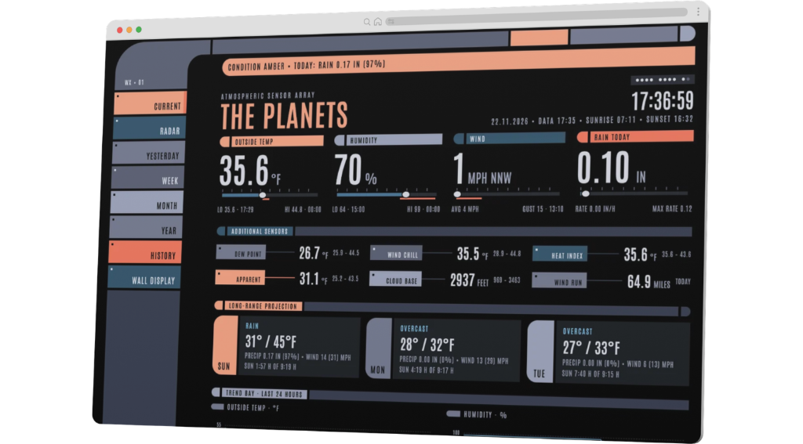

# weewx-lcars

An LCARS-style skin for [WeeWX](https://weewx.com) 5, built on the Titan.DS color palette: slate and gunmetal frames, steel-blue and peach accents, sky-blue linework, and a red alert that follows real weather warnings.

[](https://wx.roskos.me)

**Live demo:** [wx.roskos.me](https://wx.roskos.me)

| Page | What it shows |
|---|---|
| `index.html` | Console: slider gauges for temperature, humidity, wind and rain, additional sensors, 3-day forecast, last-24-hour charts |
| `radar.html` | Sensor sweep: live NEXRAD radar in a circular scope with true-distance range rings, wind rose, readouts and solar track |
| `kiosk.html` | 16:9 wall display with segmented meters; scales to any screen and reloads itself |
| `yesterday` / `week` / `month` / `year` | Recorded extremes and aggregated charts for the period |
| `history.html` | Consolidated history & archive: all-time extremes, heat-tinted monthly climate matrices, historical charts, per-year/month archive pages, and NOAA reports |

Tested against WeeWX 5.1.0, 5.5.2 and 5.6.0.

## Install & Upgrade

Run the same commands for a fresh install or an in-place upgrade (WeeWX 5):

```bash
sudo weectl extension install https://github.com/kc9wwh/weewx-lcars/releases/latest/download/weewx-lcars.zip
sudo systemctl restart weewx
```

*(For a `pip` / virtual environment install, activate your venv and omit `sudo`.)*

The installer adds a `[[LCARSReport]]` section to `weewx.conf` that writes the site to an `lcars` folder inside your `HTML_ROOT` alongside your existing skin. When upgrading, install directly **without** running `weectl extension uninstall` first so your `[[[Extras]]]` overrides in `weewx.conf` are preserved.

See the [FAQ](#faq) for immediate page generation, making LCARS the front page, distro-specific skin paths, uninstalling, and troubleshooting.

## Settings

Everything is in `skins/LCARS/skin.conf` under `[Extras]`. Override values in `weewx.conf` instead, so upgrades don't overwrite them:

```
[[LCARSReport]]
    skin = LCARS
    enable = true
    HTML_ROOT = /var/lib/weewx/www/lcars
    [[[Extras]]]
        forecast_days = 5
        kiosk_refresh = 60
```

| Setting | Default | What it does |
|---|---|---|
| `station_title` | `location` from weewx.conf | Name on every page |
| `pwa_short_name` | derived from `station_title` | Short home-screen label for the installed PWA |
| `secondary` | dewpoint, windchill, heatindex, appTemp, cloudbase, barometer | Additional sensors, in order. Sensors with no data are skipped |
| `highlight` | appTemp | Sensor that gets the coral connector line |
| `kiosk_meters` | outTemp, outHumidity, dewpoint, windSpeed, cloudbase, rain | The six wall-display meters |
| `kiosk_refresh` | 300 | Seconds between wall-display reloads (minimum 60) |
| `forecast`, `forecast_days` | true, 3 | Open-Meteo forecast |
| `nws_alerts` | true | US National Weather Service alerts. Severe or extreme alerts trigger red alert; others trigger amber |
| `amber_gust`, `amber_precip_probability` | 40, 80 | Today's forecast thresholds for condition amber (gust in your wind units) |
| `radar_rings`, `radar_ring_unit` | 5, 10, 15, 20 / mi | Range rings on the radar scope |
| `radar_tiles`, `basemap_tiles` | IEM NEXRAD, CARTO dark | Map tile sources |

Gauge scales follow your unit system (°F/°C, mph/km/h/m/s/knots, in/mm, inHg/hPa).

## Mobile & PWA

Narrow screens (`<= 860px`) switch from the left rail to a slim top LCARS elbow bar, a 2-column primary reading grid, compact wire-connected sensor rows, and a bottom navigation dock with an auxiliary drawer (`More`) for all 8 views, quick refresh, and app installation. The wall display (`kiosk.html`) also adapts into a scrollable 3×2 vertical meter console when viewed in phone portrait orientation while keeping the scaled 16:9 stage in landscape.

`manifest.webmanifest` and `sw.js` enable Progressive Web App installation on iOS and Android (Add to Home Screen / Install app) with offline shell caching and automatic stale-data refresh on resume. Service workers and browser install prompts require serving the site over **HTTPS** (or `localhost` for testing).

## FAQ

### How do I regenerate pages right away?

Without waiting for the next archive cycle:

```bash
cd /tmp && sudo -u weewx weectl report run LCARSReport
```

*(For a `pip` / virtual environment install, activate your venv and run `weectl report run LCARSReport` as your own user.)*

### How do I make LCARS the front page?

Point your web server at the `HTML_ROOT` folder and redirect `/` to `/lcars/`. With Caddy:

```
:8080 {
    root * /var/lib/weewx/www
    redir / /lcars/
    file_server
}
```

### How do I install a specific release, offline zip, or the main branch?

Pass a tagged release URL, a local zip downloaded from [Releases](https://github.com/kc9wwh/weewx-lcars/releases), or the `main` branch archive directly to `weectl extension install`:

```bash
# Specific release
sudo weectl extension install https://github.com/kc9wwh/weewx-lcars/releases/download/v<version>/weewx-lcars-<version>.zip

# Local / offline zip
sudo weectl extension install weewx-lcars-<version>.zip

# Latest unreleased commit on main
sudo weectl extension install https://github.com/kc9wwh/weewx-lcars/archive/refs/heads/main.zip
```

### WeeWX didn't find the LCARS skin after installing (Arch / custom package installs)

`weectl extension install` copies skins into `<WEEWX_ROOT>/skins`, but some packages read skins from somewhere else. Check that the folder ended up where WeeWX looks:

```bash
grep -nE '^\s*(WEEWX_ROOT|SKIN_ROOT|HTML_ROOT)' /etc/weewx/weewx.conf
ls -d /usr/share/weewx/skins/* /etc/weewx/skins/* /usr/lib/weewx/skins/* 2>/dev/null
```

If `LCARS` landed somewhere other than `[StdReport]`'s `SKIN_ROOT`, symlink it into `[StdReport]`'s `SKIN_ROOT` (instead of setting a per-report `SKIN_ROOT` under `[[LCARSReport]]`, which WeeWX's `CheetahGenerator` ignores when reading `skin.conf` and `.tmpl` files):

```bash
# Example when WEEWX_ROOT is /usr/lib/weewx and [StdReport] SKIN_ROOT is /etc/weewx/skins
sudo rm -rf /etc/weewx/skins/LCARS
sudo ln -s /usr/lib/weewx/skins/LCARS /etc/weewx/skins/LCARS
```

Future `weectl extension install` upgrades will then update `<WEEWX_ROOT>/skins/LCARS` in place and both `CheetahGenerator` and `CopyGenerator` will stay in sync.

### Pages stopped updating or logs show Permission denied

The WeeWX service runs as its own user (usually `weewx`). Running `weectl report run` with plain `sudo` creates root-owned files, and the service then fails every cycle with `Permission denied`. Check `journalctl -u weewx | grep LCARSReport`, then make sure `weewx` owns the output folder and run any manual report as that user, from a directory it can enter:

```bash
sudo chown -R weewx:weewx /var/lib/weewx/www/lcars        # use your HTML_ROOT
cd /tmp && sudo -u weewx weectl report run LCARSReport
```

### CSS or script changes don't appear after upgrading

If your site sits behind a caching proxy or CDN (such as Cloudflare) and styling or script changes do not appear after upgrading, purge the cached `lcars.css` and `lcars.js` files.

### How do I uninstall?

```bash
sudo weectl extension uninstall lcars
sudo systemctl restart weewx
```

*(For a `pip` / virtual environment install, activate your venv and omit `sudo`.)*

This removes the installed skin files and the `[[LCARSReport]]` section from `weewx.conf`. Generated HTML files under `<HTML_ROOT>/lcars` can be deleted manually if no longer needed.

## Development

```bash
pip install weewx                    # any WeeWX 5.x
scripts/test-render.sh               # builds a simulator station, renders every page, validates the output
python3 -m http.server -d <printed output path> 8000   # preview in a browser
scripts/build.sh                     # dist/weewx-lcars-<version>.zip and dist/weewx-lcars.zip
```

`test-render.sh` runs on every push via GitHub Actions against several WeeWX versions; the rendered site is attached to each run as an artifact.

### Layout

```
install.py                  weectl extension installer (version lives here)
skins/LCARS/
  skin.conf                 settings, labels, generator config
  index.html.tmpl           console
  radar.html.tmpl           radar scope
  kiosk.html.tmpl           wall display
  history.html.tmpl         consolidated history & archive console
  archive.json.tmpl         archive index manifest for progressive navigation
  manifest.webmanifest.tmpl Web App Manifest for PWA installation
  yesterday|week|month|year.html.tmpl   thin wrappers around inc/period.inc
  year-%Y.html.tmpl         archived year wrapper around inc/period.inc
  month-%Y-%m.html.tmpl     archived month wrapper around inc/period.inc
  NOAA/                     NOAA-format monthly & yearly text summary templates
  inc/                      shared Cheetah includes (frame, records, config JSON, chart data, NOAA modal)
  lcars.css                 all styling; palette tokens at the top
  lcars.js                  gauges, meters, forecast, alerts, charts, radar map, kiosk, history matrix, NOAA viewer, mobile nav, PWA
  sw.js                     service worker (network-first weather pages, cache-first bundled assets)
  fonts/, icons/, vendor/   bundled Antonio, PWA PNG icons, ApexCharts, Leaflet
```

Template notes: WeeWX's `$obs.label` needs `[key]` access, while `$unit.label` and `$unit.unit_type` need `getattr`. Avoid `#errorCatcher`, because it breaks expressions that start with a quote. Use `#set global` to pass values into includes; macros defined in an include are not visible to the page that includes it.

### Releasing

1. Bump `VERSION` in `install.py` and `SKIN_VERSION` in `skins/LCARS/skin.conf`, and add a `CHANGELOG.md` entry.
2. Tag and push: `git tag v0.2.0 && git push --tags`.
3. The Release workflow runs the render test, builds both zips (`weewx-lcars-<version>.zip` and `weewx-lcars.zip`), and attaches them to a GitHub release.

## Data sources

- Forecast: [Open-Meteo](https://open-meteo.com/) (CC BY 4.0), fetched by the browser. No key needed.
- Alerts: US National Weather Service, `api.weather.gov`. US only.
- Radar: NEXRAD composite tiles from the [Iowa Environmental Mesonet](https://mesonet.agron.iastate.edu/). US only.
- Basemap: CARTO dark, OpenStreetMap data.

## License

MIT, see `LICENSE`. Bundled third-party files keep their own licenses (`skins/LCARS/LICENSES.txt`): Antonio (SIL OFL 1.1), ApexCharts (MIT), Leaflet (BSD-2-Clause).

Star Trek and LCARS are trademarks of CBS Studios / Paramount. This is a fan-made, non-commercial theme with no official logos or insignia. Color palette inspired by [Titan.DS by meWho](https://www.mewho.com/titan/).
